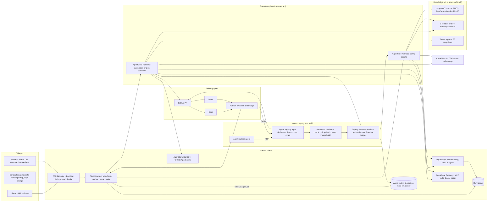

# Fai architecture on AWS: Q4 draft

Draft for Chuck's review. Not a decision record. Facts about AWS come from the AgentCore harness GA post and AgentCore developer docs. Anything I could not confirm is marked **Unverified**. Items marked **Proposed** are my suggestions, not decisions you have made.

## Summary

Fai runs on AWS by default and moves off AWS only when a tripwire (listed below) trips. The design has six parts:

1. **Agent definitions** are versioned files in git. They say what each agent is: model policy, instructions, skills, tools, limits, owner, triggers. They are built from open standards (AGENTS.md, Agent Skills, MCP) and mirror the AgentCore harness config.
2. **Temporal** owns every run's lifecycle: intake, retries, waits for humans, and the run record. It sends a slim run request that points at an agent definition.
3. **AgentCore Runtime** hosts coding agents in a container you control. The harness inside is chosen by Spike A from three candidates: the Strands harness, OpenCode, and pi.
4. **AgentCore harness** hosts config-defined agents (meeting synthesis, agent builder, project sync, staleness check).
5. An **AI gateway** sits in front of models. Bedrock is the first provider behind it.
6. A thin **run contract** keeps hosts swappable. Every run, whatever hosts it, takes the same request and returns the same result.

The factory builds its own agents. An agent builder agent, itself defined in the same format, opens PRs to the agent registry. A pipeline validates, evals, and deploys merged definitions. Humans merge everything. Gitar and Sonar stay as the PR gates. Knowledge lives in git (the companyOS repos and ai-toolbox), not in the platform.

## Design decisions this draft assumes

| Decision | Choice | Source |
|---|---|---|
| Cloud | AWS until it stops working | Chuck |
| Hosting split | AgentCore harness for config agents, AgentCore Runtime with a bring-your-own harness for coding agents | Chuck |
| Durable orchestration | Temporal | Chuck |
| Coding agent harness | Open. Strands harness, OpenCode, and pi are compared in Spike A. Strands harness is the leading candidate to test because the AgentCore managed harness is Strands-based. | Chuck, Proposed |
| Model access | AI gateway, Bedrock first behind it | Chuck |
| Q4 sandbox scope | Factory repos plus one non-fn-core repo | Chuck |
| Merge authority | Humans merge. Gitar and Sonar gate. | Q4 OKR, Fieldworks brainstorm |
| Skills location | ai-toolbox and the FN marketplace, not the OS repos | Chuck, Cory DM |
| Temporal hosting | Temporal Cloud, already in use at Field Nation | Chuck |
| GitHub access | One GitHub App for all of Fai. A per-run installation token is minted by the Temporal workflow. May split into multiple Apps later. | Chuck |
| Definition format | Thin envelope that mirrors the AgentCore harness config | Chuck |
| Agent storage | Definitions in a dedicated registry repo, deployed by a pipeline | Chuck |
| Skill version pinning | Deferred. Not solved in Q4. | Chuck |
| Agent creation | Agent builder agent opens PRs to the registry. It cannot merge or widen its own permissions. | Proposed |

## System diagram



## Agent definitions and the run contract

Two things are kept apart. The **agent definition** is static and versioned. The **run request** is per invocation and thin.

### Agent definition

Prefer open standards. Only the governance envelope is ours. The definition file is built from these layers (research and sources in the companion document on definition standards and AgentCore deployment):

- **Instructions:** `instructions.md`, plain Markdown in the AGENTS.md style.
- **Skills:** Agent Skills folders (`SKILL.md`), the ai-toolbox format. OpenCode, pi, and the AgentCore harness all consume it.
- **Tools:** MCP servers, registered as AgentCore Gateway targets.
- **Core config:** field names and shapes mirror the AgentCore harness config (the CloudFormation `AWS::BedrockAgentCore::Harness` schema), so deployment is a direct mapping.
- **`fn` block:** owner, tool tier, triggers, evals, host type. This is the only part we define.

No single standard covers a whole agent. Strands AgentConfig (JSON with `model`, `prompt`, `tools`) is experimental, takes only a Bedrock model ID, uses Python module paths for tools, and has no owner, tier, trigger, or eval fields, so it is not a base for the envelope. Oracle's Open Agent Specification is the closest, but it has no AgentCore adapter and does not cover deployment, identity, or permissions, so this draft does not adopt it.

```yaml
# agents/meeting_synthesis/agent.yaml  (illustrative values)
agentId: meeting_synthesis          # AgentCore name rules: letters, digits, underscore, max 40
fn:
  owner: team:eng-leadership        # a named human or team, required
  description: Turn a meeting transcript into a sourced record in the Engineering Senior Leadership OS.
  host: harness                     # harness | runtime
  toolTier: 1                       # 1 read-only, 2 write or sensitive, 3 new MCP servers
  repos:
    - name: os-eng-leadership
      access: pr-only               # branch and PR, never merge
  triggers:
    - type: event
      name: transcript-dropped
  evals: ./evals/                   # cases that gate every change to this definition

harness:                            # mirrors the AgentCore harness config
  model:
    provider: openAi                # OpenAI-compatible endpoint, so calls go through the AI gateway
    apiBase: https://ai-gateway.internal.example/v1   # placeholder
    modelId: <gateway-model-alias>
  systemPrompt: ./instructions.md   # rendered into SystemPrompt at deploy time
  skills:
    - s3: { uri: s3://fai-skills/meeting-synthesis/ }   # version pinning deferred, see rules
  tools:
    - type: agentcore_gateway
      name: tier1
      config: { agentCoreGateway: { gatewayArn: <tier-1 gateway ARN> } }
  allowedTools: ["@tier1/*"]        # guides the model only. Cedar policy enforces.
  memory: { disabled: {} }
  maxIterations: 40
  maxTokens: 50000
  timeoutSeconds: 1200

# runtime agents replace the harness block with:
# runtime:
#   image: <ecr uri>                # OpenCode or pi baked in, linux/arm64, serves /invocations and /ping
#   lifecycle: { idleRuntimeSessionTimeout: 900, maxLifetime: 14400 }
#   network: { mode: VPC }
```

Rules:

- Every agent has a named owner.
- The tool tier is a request. The AgentCore Gateway Cedar policy and the generated IAM role enforce it. Raising `toolTier` or adding a tool target needs approval from the tool approval group (a dedicated group that likely includes security).
- Changes to instructions, skills, or limits need the owner's review and passing evals.
- Skill version pinning is deferred. Skills load from their current location, so a run's skills can change between runs. The harness skills reference shows no pin field for Git or S3 sources, which is why this is not solved yet. Revisit before the agent count grows. Until then the ledger records the agent version but not skill content.
- The harness caps iterations, output tokens, and wall time. It has no dollar cap, so spend limits live in the AI gateway.
- Git tags use SemVer. AgentCore versions are integers. The agent index maps one to the other.

### Run request

Temporal builds the request from the definition and the trigger. It carries only what varies:

- `run_id`
- `agent_id` and `agent_version`, resolved from the agent index and pinned for the run
- `trigger` (Linear issue ID, schedule, event, human)
- `inputs` and target `repos` with refs
- `overrides` (optional)

Overrides can only narrow what the definition allows. A run can lower the spend cap. It cannot add a tool, raise the tool tier, or swap skills.

### Run result

- `status` (succeeded, failed, blocked, needs_human) and `failure_reason`
- `outputs` (PR URL, files written, links to source records)
- `trace_id`, `duration`, `tokens`, `cost`
- `session_ref` so a human can resume where the agent stopped

Every run records its `agent_version` in the ledger, so any PR can be traced to the exact instructions, skills, and limits that produced it. Every run emits the same trace and cost fields, which is what lets the Q4 report show a numerator, denominator, and baseline for each KR.

## How agents are stored

Git is the source of truth for agents, the same way it is for knowledge and skills.

### Registry repo

A dedicated registry repo (name to be chosen, for example `fai-agents`) with one directory per agent:

```text
agents/
  meeting-synthesis/
    agent.yaml
    instructions.md
    evals/
  agent-builder/
    ...
templates/
  harness-agent/        # starting point for config agents
  runtime-coding-agent/ # starting point for OpenCode or pi agents
schema/
  agent.schema.json
CODEOWNERS
```

`CODEOWNERS` maps each agent directory to its owner. Changes to `tools` fields also require the tool approval group as a required reviewer. The repo is covered by Gitar and Sonar like any other.

Skills do not live here. Definitions reference skills in ai-toolbox or the FN marketplace. Version pinning is deferred.

### CI on every PR (Harness)

1. Validate `agent.yaml` against the schema. Fail if there is no owner or the tool tier exceeds what the owner may request.
2. Policy check: model names are in the gateway allowlist, tool targets exist in the AgentCore Gateway catalog, repo access is `pr-only`.
3. Run the agent's evals in a sandbox. MOI-105 and MOI-145 are the eval path for ai-toolbox, and the same engine gates definitions. Strands Evals (Python-only, 25+ built-in evaluators, user and tool simulators, red teaming) is a candidate for this gate and should be compared with Harness Evals and DeepEval before the engine is fixed.
4. For Runtime agents, build the container image and push it to ECR. Most Runtime agents share one base image with OpenCode or pi installed. The image stays under the 2 GB limit.

### Deploy on merge

- **Harness agents:** create or update the harness (CloudFormation `AWS::BedrockAgentCore::Harness`, the Terraform `aws_bedrockagentcore_harness` resource, or the API). Each update creates an immutable integer version, and the `DEFAULT` endpoint moves to it automatically. Point the `staging` endpoint at the new version with `TargetVersion`, then move `prod` after a smoke run. Rollback is the same update with an earlier version (inferred, not documented, so test it). Temporal always invokes a named endpoint, never `DEFAULT`. AgentCore allows 10 endpoints per agent, 1,000 versions per agent, and 1,000 agents per account by default.
- **Runtime agents:** deploy the new image with `create_agent_runtime` (or the Terraform resource), then move the named endpoint with `update_agent_runtime_endpoint`.
- **Per-agent IAM role:** generate the execution role from the definition. The tool tier decides which optional statements it gets (S3 skill reads, credential providers, Gateway invoke, hook targets).
- **Triggers:** register the definition's triggers (Linear label, schedule, event) with the intake Lambda and Temporal schedules. Removing a trigger from a definition removes it on deploy.
- **Agent index:** the pipeline writes one row per deployed agent: `agent_id`, `agent_version`, `host` and its ARN, `owner`, `status`. Temporal resolves `agent_id` through this index and never reads git at run time.

Infrastructure as code: CloudFormation has harness and harness endpoint resources, and Terraform has a harness resource and Runtime resources. The Terraform listing I found had no harness endpoint resource. OpenTofu with the AWS provider fits the existing `fn-opentofu-module` standard, with CloudFormation or an API call for any gap. Details are in the companion research document.

## How the factory builds agents

**Proposed.** The Q4 milestone "agents can be defined by config and deployed through the Factory" is delivered by an **agent builder agent** that uses the same path as every other change.

### The flow

1. A human asks for an agent: a Linear issue with an `agent-request` label, a Slack message, or a CLI call. The request names the purpose, the owner, the inputs, and the outputs.
2. The intake Lambda starts a Temporal workflow. It runs the agent builder agent like any other agent, with an ordinary run request.
3. The builder:
   - Picks a template from `templates/` based on the purpose (config agent or coding agent).
   - Drafts `agent.yaml`, `instructions.md`, and starter `evals/`.
   - Reuses existing skills from ai-toolbox where they fit. If a needed skill does not exist, it files a ticket instead of writing a one-off copy in the registry.
   - Opens a PR to the registry repo.
4. CI validates, runs evals, and builds. Gitar and Sonar review the PR.
5. The named owner reviews. The tool approval group reviews if the definition uses tier 2 or tier 3 tools. A human merges.
6. The deploy pipeline publishes the agent to `STAGING` and updates the agent index.
7. The owner runs a smoke test, then promotes to `PROD`. The agent appears in the index and, later, on the command center map.

### Guardrails on the builder

- It has PR access to the registry only. It cannot merge, approve, or edit `CODEOWNERS` or the schema.
- It cannot create an agent with a higher tool tier than the requester could approve. The tier is a request that a human approves.
- It cannot edit its own definition. Changes to `agent-builder` need the Fai team as reviewers like any other tier 3 change.
- It sets `owner` to the requester, so no agent exists without a named human.

### Bootstrapping

The first two definitions are hand-written: `agent-builder` and `meeting-synthesis`. The meeting synthesis agent is the first deployed through the pipeline, which proves the path. After that, new agents come from the builder. The scaffolder, project sync, and staleness check in the Q4 milestone become the first agents the builder creates, and they maintain FNOS and the Engineering Senior Leadership OS.

### Scope for Q4 and after

Q4 covers platform-owned agents only. Anyone on the team can request an agent, and the Fai team owns the review. User-deployed agents (levels 1 and 2 in the Fieldworks vision) arrive in a later phase. The same flow supports them: a non-engineer files the request, the builder drafts it, and only open-tier tools are allowed without approval.

## Components

### Intake and triggers

Linear webhooks, schedule events, and GitHub events land on API Gateway and a Lambda that authenticates, deduplicates, and starts a Temporal workflow. The Lambda holds no business logic. Only issues with the agreed eligibility label start coding runs.

### Orchestration: Temporal

One workflow per run. The workflow:

1. Resolves the agent definition version from the agent index and creates the run record in the ledger (this is "Factory first substantive work" for KR1).
2. Calls the execution host through an activity.
3. Waits for PR events, Gitar and Sonar results, and human review as signals or timers. These waits can last days, which is why the durable layer sits outside AgentCore sessions (8 hour maximum, 15 minute idle timeout by default).
4. Records merge, rejection, or failure.

Activities that call external systems use idempotency keys, because Temporal retries them.

AgentCore can host Temporal workers (serverless workers invoked on demand). Temporal describes that integration as **prerelease**. Plan to run workers on ECS or EKS if the AgentCore path is not stable enough, since workers are plain processes and not part of the run contract.

Field Nation already has Temporal Cloud, so no hosting choice remains. Workers are the only part we run.

### Execution plane

**Coding agents: AgentCore Runtime, bring-your-own harness.** Package the chosen harness in an ARM64 container, push it to ECR, and deploy to Runtime. You own the agent loop. Runtime is the only route to a harness other than the managed one, because the managed harness is Strands-based and the Claude Agent SDK export is listed as coming soon.

**Harness candidates.** The **Strands harness** (open source, Apache 2.0, announced 2026-09-21, Python and TypeScript) is an assembled harness with shell, read/write/edit, and web tools, MCP, skills, sub-agents, memory, session resume, prompt caching, and compaction at 85% of context. It supports Bedrock, Anthropic, OpenAI, Google, Ollama, and LiteLLM, and runs in any Linux container, AgentCore included. Its authors report 28% lower cost than other harnesses at equal or better accuracy, and 77% lower cost than Claude Code on Terminal Bench 2.1. Those figures are the authors' own and a paper is pending. Open points: the post calls it general-purpose and not a coding agent, it is about two weeks old, it does not say whether it accepts an arbitrary OpenAI-compatible base URL (LiteLLM is the listed route), and it does not describe sandbox behavior. If it passes Spike A, one harness family covers both hosts and the BYO-harness split mostly disappears. The run contract keeps the choice swappable. At start, the entrypoint reads the agent definition for its version, configures the harness (model through the gateway, skills, MCP config), and runs the task.

Facts that shape the sandbox:

- Each session runs in its own Firecracker microVM.
- Per-session hardware is capped at 2 vCPU and 8 GB. Container images are capped at 2 GB. Neither limit is adjustable on the default microVM compute type.
- Runtime **Instances** (August 2026) is a second compute type: EC2 instances AgentCore manages in your account, sessions up to 14 days, GPU families, VPC only, `x86_64` and `arm64`. The docs I read give no instance sizes. Check it first for the fn-core question.
- Maximum session lifetime is 8 hours (adjustable). Idle timeout is 15 minutes (adjustable). Synchronous requests time out at 15 minutes. Asynchronous jobs can run up to 8 hours.
- Managed session storage is 1 GB per session. Larger working sets need EFS or S3 Files, and both require VPC mode.
- Defaults per account: 5,000 active sessions in us-east-1 and us-west-2, 25 new sessions per second.

Third-party proof that coding CLIs run on Runtime: a Classmethod writeup ran Claude Code and Codex CLI through a Runtime execution role against Bedrock, but only with a hello-world prompt. **Unverified:** the Strands harness, OpenCode, or pi on Runtime doing a real coding task with MCP, git, and tests. That is the first spike.

**Config agents: AgentCore harness.** `CreateHarness` and `InvokeHarness` define and run an agent from configuration: model, instructions, tools, skills, memory, limits. Each update creates an immutable version, and named endpoints (for example `STAGING`, `PROD`) pin versions. Skills load from git or S3. The agent definition maps almost one to one onto the harness config. There is no harness fee. You pay for Runtime compute ($0.0895 per vCPU-hour and $0.00945 per GB-hour of active use), Gateway, Memory, CloudWatch, and model inference.

**Workspace bootstrap.** Each repo has a snapshot in S3, refreshed on PR merge or on a cron. A new session restores the snapshot and runs a `git fetch` to pick up the delta, so start time stays short. With 1 GB of managed session storage, larger repos need an EFS or S3 Files mount or a shallow clone. The harness `InvokeAgentRuntimeCommand` API can run this setup step without spending model tokens.

### Model access: AI gateway

Agents never call model providers directly. They call the AI gateway, which holds provider keys, enforces per-run budgets, and records tokens and cost against `run_id`. Bedrock is the first provider and supports Claude and OpenAI GPT-5.x in-boundary.

AgentCore Gateway does not do this job. It brokers tools (OpenAPI, Smithy, Lambda, MCP), not model calls.

The harness accepts an OpenAI model configuration with an `apiBase` for routing through a gateway or proxy, and OpenCode and pi can point at an OpenAI-compatible endpoint. **Unverified:** whether per-run headers (a run ID for cost capture) can be sent on the harness path. **Open choice:** buy or compose the gateway (LiteLLM-class, a vendor, or an AWS-native pattern).

### Tool access: AgentCore Gateway

MCP servers (Linear, GitHub, Sonar, and later Datadog) register as Gateway targets. Cedar policies gate calls by caller, condition, and arguments. A harness that references a gateway gets every tool on it, and `allowedTools` only guides the model, so use one gateway per tool tier and let Cedar name which agents may use each. Lifecycle hooks (a Lambda can allow or deny at `before_tool_call`) log every tool call to the run ledger and can block pushes to protected branches. Tools are tiered:

- Tier 1: read-only, open to any agent.
- Tier 2: write or sensitive data, granted per agent with a named approver.
- Tier 3: new MCP servers, reviewed before entering the catalog.

The tier in an agent definition is the request. The Gateway policy is what enforces it, so editing a definition cannot grant a tool by itself.

### Identity

Each agent is its own principal with a named owner. AgentCore Identity holds workload identities and the token vault. For GitHub, Fai starts with one GitHub App for everything. The Temporal workflow mints a short-lived installation token per run, scoped to the target repo, so the agent can push a branch and open a PR but cannot merge. AgentCore Identity's documented providers cover API keys and OAuth2, not GitHub App tokens, so the workflow injects the token into the session. With one App, its permissions are the ceiling for every agent, so keep them to contents and pull requests write, and rely on per-run repo scoping. Splitting into multiple Apps (for example registry versus product repos) is a later option. Branch protection and CODEOWNERS enforce the human merge. Okta remains the human identity provider.

**Unverified:** whether tokens placed in the sandbox are visible to the agent's shell. Assume they are, and keep their scope minimal.

### Knowledge layer

Git is the source of truth. The companyOS repos (FNOS and the Engineering Senior Leadership OS) have a root `AGENTS.md` and an `AGENTS.md` in each part intended to be worked on in isolation. Skills live in ai-toolbox and the FN marketplace and are pulled into runs. They do not live in the OS repos or the agent registry.

Agents write to the OS repos through PRs, and each OS has a named human owner who reviews. Goals and decisions carry a current and an archive area. Archived content is skipped by default, and anything not marked current is a hint, not a source of truth.

Review-relevant skills are also committed in each repo, because vendor-hosted review reads repo content only.

### Delivery gates

The factory opens a PR on a branch. Gitar and Sonar run as they do today. A human reviews and merges. No agent holds merge permission in Q4. This applies equally to PRs against product repos, the OS repos, and the agent registry.

### Observability, cost, and the run ledger

AgentCore traces to CloudWatch, including a GenAI Observability view per harness, session, and trace. Forward traces to Datadog through OpenTelemetry. **Unverified:** the exact forwarding path from AgentCore to the existing `ai-harness-otel` index.

AWS documentation does not describe per-agent or per-run cost attribution for AgentCore. The design therefore does not depend on it. The AI gateway records model cost by `run_id`, and the Temporal workflow records sandbox seconds from the Runtime session. The ledger sums them and joins on `agent_id` and `agent_version`. AWS cost allocation tags are a cross-check, not the source.

The **run ledger** (a small Postgres or DynamoDB table) is the source of truth for KR measurement. Each row holds issue start, Factory takeover, PR opened, review events, merge, failure, cost, tokens, and agent version. Deployment and defect data join in from Harness and Linear for the KR3 numerators and denominators.

## Q4 walking skeleton

Smallest slice that satisfies the Walking skeleton milestone:

1. Hand-write the `meeting-synthesis` definition and deploy it through the pipeline to a harness `STAGING` endpoint.
2. A schedule or manual trigger starts a Temporal workflow, which resolves the agent from the index.
3. The agent calls a model through the AI gateway, using a marketplace skill.
4. It writes a sourced meeting record to the Engineering Senior Leadership OS through a PR.
5. The ledger shows the run's identity, agent version, trace link, and cost.

The first coding slice repeats the pattern with an OpenCode or pi container on Runtime, a Linear issue as input, and a PR as output.

## Build order and Q4 mapping

| Order | Work | OKR milestone |
|---|---|---|
| 1 | Spike A: Strands harness, OpenCode, and pi in a Runtime container (MCP, git, tests, Bedrock through the gateway), plus Strands Evals against Harness Evals and DeepEval for the eval gate. Spike B: cost capture by `run_id`. | Platform decision gate |
| 2 | Agent definition schema, registry repo, CI skeleton | Walking skeleton |
| 3 | Run contract, Temporal workflow skeleton, agent index, ledger | Walking skeleton |
| 4 | Deploy pipeline for harness agents. Meeting-synthesis agent writing to the Eng Senior Leadership OS. | Walking skeleton |
| 5 | Agent builder agent. Scaffolder, project sync, and staleness check built through it. | Agent creation and companyOS |
| 6 | Deploy pipeline for Runtime agents. Linear to PR run on a factory repo, through Gitar and Sonar. | First Factory-completed issue |
| 7 | Add one non-fn-core repo, tune snapshots and limits | Factory pilot |

## Tripwires: when AWS stops working

Move a component to another host (ECS or EKS behind the same run contract) if any of these hold after the spikes:

1. None of the Strands harness, OpenCode, or pi can run a real coding task in a Runtime container with MCP, git, and tests.
2. The 2 vCPU, 8 GB, or 2 GB image limits block the non-fn-core repo test, and neither EFS or S3 Files nor Runtime Instances fixes it.
3. Runtime cannot reach GitHub from VPC mode without an egress path the security team accepts.
4. Per-run cost cannot be captured to within a tolerance you and Cory set.
5. Temporal workers cannot run reliably on AgentCore and ECS or EKS is needed (this moves workers only, not the agents).

fn-core is outside Q4 scope. Run it as a recorded spike: does the fn-core sandbox image fit the 2 GB and 8 GB limits.

## Risks and unknowns

- **Security docs.** The harness security page I read is the China regions version. Confirm isolation, network, and audit behavior in the target region. The page does not cover CloudTrail per-action audit, egress allowlisting, or GitHub token exposure.
- **Skills from git are trusted.** Callers can override the `skills` field per invocation. The run request therefore never accepts skills overrides. Only the deployed definition sets them.
- **Model parameters pass through.** `additionalParams` can redirect endpoints and override headers. Restrict it.
- **Self-modifying risk.** An agent that creates agents can widen its own reach. The guardrails on the builder (PR-only, no self-edit, human approval of tool tiers) are what contain this.
- **Harness maturity.** The CLI quickstart still installs `@aws/agentcore@preview` although the harness is listed as GA.
- **Strands harness maturity and claims.** It is two weeks old at the time of writing, and its cost and accuracy numbers come from its authors.
- **Strands interventions and Box.** The Strands SDK lists Cedar authorization, steering, and human-in-the-loop interventions that gate tool calls inside the agent loop. They could add a second enforcement point beside AgentCore Gateway Cedar, and the relationship is not yet understood. Strands Box (OS containment plus a policy file, with a network allowlist and API key injection) could address the GitHub token exposure question, but it is pre-release (0.1.x), the guide targets macOS, and it asks you to turn off sessions, memory, and skills. Revisit both after Spike A. Do not plan on them.
- **Small sample size.** With 20 completions as the target, percentage rates are volatile. Report counts with every rate.
- **Team capacity.** The build list above is wider than a team of four with other commitments can finish in one quarter. Items 5 and 7 are the first to slip.

## Questions for Chuck and Cory

Answered and folded in above: thin envelope, dedicated registry repo, Temporal Cloud, one GitHub App, skill pinning deferred.

1. **Who is on the tool approval group** for tier 2 and tier 3 changes? Is security (Ben's team) a required reviewer from day one?
2. **Agent index home:** the same database as the run ledger, or separate?
3. **AI gateway:** buy or compose, and who owns it? It is the first piece with no existing foundation.
4. **Which non-fn-core repo** joins the pilot?
5. **Q4 OKR doc still lists the Platform and run contract milestone.** The Slack thread says to drop it. This draft keeps the run contract as a design rule and can seed the hosting ADR without a separate milestone.
6. **Who owns AWS account setup,** including the Bedrock IAM role that MOI-149 is waiting on?
7. **Eval engine:** Strands Evals, Harness Evals, or DeepEval for the definition gate and ai-toolbox? MOI-105 and MOI-145 already point at Harness Evals, so this is a comparison to run, not a restart.
8. **GitHub App ownership:** who creates and administers the single Fai App in the Field Nation GitHub org, and where is its private key held (AWS Secrets Manager is the likely home)?

## Sources

- [Amazon Bedrock AgentCore harness is now generally available (AWS)](https://aws.amazon.com/blogs/machine-learning/amazon-bedrock-agentcore-harness-is-now-generally-available-go-from-idea-to-production-grade-agent-in-minutes/)
- [AgentCore harness vs. Runtime](https://docs.aws.amazon.com/bedrock-agentcore/latest/devguide/harness-vs-runtime.html)
- Companion research: agent definition standards and AgentCore deployment (2026-10-07-agent-definition-standards-and-agentcore-deployment.md)
- [AgentCore quotas and limits](https://docs.aws.amazon.com/bedrock-agentcore/latest/devguide/bedrock-agentcore-limits.html)
- [AgentCore harness security (China regions version)](https://docs.amazonaws.cn/en_us/bedrock-agentcore/latest/devguide/harness-security.html)
- [Introducing Strands harness](https://strandsagents.com/blog/introducing-strands-harness/)
- [Strands Agents site](https://strandsagents.com/), [AgentConfig (experimental)](https://strandsagents.com/docs/user-guide/sdk/experimental/agent-config/), [Run the Strands harness in a box](https://strandsagents.com/docs/user-guide/box/guides/run-strands-harness/)
- [Temporal: Amazon Bedrock AgentCore with Temporal serverless workers](https://temporal.io/blog/amazon-bedrock-agentcore-with-temporal-serverless-workers)
- [Classmethod: Codex CLI and Claude Code on AgentCore Runtime](https://dev.classmethod.jp/articles/bedrock-agentcore-runtime-codex-cli-claude-code/)
- [DoiT: AgentCore per-tenant cost attribution](https://www.doit.com/blog/blog-bedrock-agentcore-per-tenant-cost-attribution)
- Q4 2026 OKR (Fai), Fieldworks brainstorm and layer mapping, and the Slack DMs with Cory from 2026-10-05 to 2026-10-07
