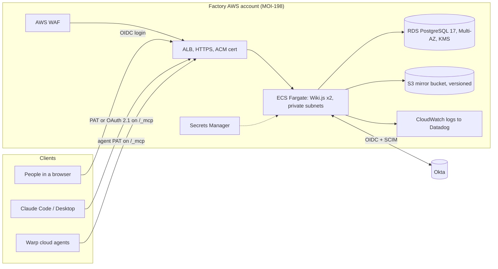

# Wiki.js on AWS with Okta: implementation plan

**Date:** 2026-11-11
**Purpose:** How to stand up Wiki.js 3.x in FN's AWS account, secured with Okta (OIDC for people, OAuth or scoped tokens for agents over MCP), as the authored store for the company second brain (MOI-204). Written for the one-week spike recommended in [research/2026-11-09-second-brain-wiki-and-graph-options.md](../research/2026-11-09-second-brain-wiki-and-graph-options.md), and meant to carry straight into production if the spike passes.
**Grounded in:** the Wiki.js repo at tags `3.0.0` and `3.3.1` (config sample, Dockerfile, Helm chart values, OIDC and S3 module definitions, `dev/specs/mcp.md`), plus the `ghcr.io/requarks/wiki` image registry. Everything not checked there is marked.

---

## 1. Facts that shape the design

- **Release cadence is fast.** Git tags `3.0.0` through `3.3.1` all landed between 2026-11-01 and 2026-11-11. `3.3.1` (today) fixes OIDC sign-in for providers that return `scope` as a list. Pin an exact version by digest and plan for weekly patch upgrades during the spike.
- **Image:** `ghcr.io/requarks/wiki`, multi-arch (amd64 and arm64), with tags `3`, `3.3`, `3.3.1`. Node 26 base, runs as the `node` user under `tini`. Puppeteer and headless Chrome are baked in, so it's a large image.
- **Database:** PostgreSQL 17 or later is required. The container reads `DB_HOST`, `DB_PORT`, `DB_USER`, `DB_PASS`, `DB_NAME`, `DB_SCHEMA` and `DB_SSL` from the environment. Everything else (auth, permissions, MCP settings) is configured in the admin UI and stored in the database.
- **It's stateless enough for HA.** Replicas coordinate through Postgres LISTEN/NOTIFY (collaborative editing included), so no sticky sessions are needed. `/wiki/data` holds only caches unless you use the Local Disk storage target or a Git target with no remote. Each replica holds 3 connections permanently, so size `pool.max` against RDS `max_connections`.
- **Health endpoints:** `/_live` (liveness) and `/_ready` (readiness; returns 503 as soon as a replica starts shutting down).
- **Behind a load balancer:** set `security.trustProxy: true`. It trusts the whole `X-Forwarded-For` chain, so the tasks must be reachable only from the ALB.
- **OIDC module:** discovery from the issuer, `mapGroups` with a `groupsClaim` that only matches groups that already exist in the wiki (nothing is auto-created), `unassignMissingGroups` to make Okta authoritative, `requireVerifiedEmail`, and ACR values if we want to require MFA. Callback URL is `{host}/_api/auth/{id}/callback`; post-logout URL is `{host}/`.
- **SCIM 2.0** is built in at `/_scim/v2`, so Okta can provision and deactivate users.
- **MCP has two ways in:**
  - **Personal access tokens (PATs).** A PAT acts as its owner on every call, under the owner's groups and page rules. It needs the `mcp` scope plus a scope for each area it touches (`pages`, `approvals`, and so on), each at read or write. The owner must also hold the `use:mcp` permission.
  - **OAuth 2.1**, with Wiki.js as its own authorization server (discovery, dynamic client registration, PKCE, consent screen). This is for clients like claude.ai and ChatGPT connectors that can't send a static header.
  - **System API keys are refused on `/_mcp`.** Every agent needs a user identity, which fits the "agent is a principal with a named owner" rule.
- **Agent writes can be forced into review.** `suggest_edit` sends an edit to the approvals queue when the caller lacks write access. Writes carry a reason and are marked "via MCP" in history.
- **S3 storage target** mirrors pages and assets to a bucket using the task's IAM role (leave the keys empty). That gives us markdown backup and the input for the graph build later.

## 2. Target architecture

| Component | Choice | Notes |
|---|---|---|
| Compute | ECS Fargate, 2 tasks across AZs, ~1 vCPU / 2 GB each (starting point, unverified) | Mirror the image into ECR and pin by digest. Arm64 (Graviton) works. |
| Database | RDS PostgreSQL 17, Multi-AZ, encrypted, `DB_SSL=true` with the RDS CA | Automated backups with point-in-time restore. Credentials from Secrets Manager. |
| Ingress | Internet-facing ALB with an ACM cert, HTTPS only, WAF managed rules plus rate limiting | Warp cloud agents and OAuth connectors need to reach `/_mcp`, so the endpoint can't be VPN-only. The tasks' security group allows only the ALB. |
| DNS | e.g. `brain.fieldnation.com` (name TBD) | One hostname. OAuth metadata and site mapping are per hostname. |
| Storage target | S3, versioned, Block Public Access, bucket policy limited to the task role plus break-glass | Holds every tier, so treat it like the database. Skip the Git target, because a GitHub mirror recreates the original repo-access problem. |
| Egress | NAT gateway | Needed for Okta discovery and token exchange, plus icon lookups from Iconify unless `offline: true`. |
| Logs | `logFormat: json` to CloudWatch, forwarded to Datadog | Also use the wiki's audit log and the MCP contributions card under Admin > MCP. |
| IaC | OpenTofu through Harness IaCM | Same toolchain as MOI-185's design. That design was GCP-only, so this would be its first AWS use. |

## 3. Okta setup (needs an Okta admin)

1. **Create an OIDC Web App** with the authorization code grant. Sign-in redirect: `https://<host>/_api/auth/<strategy-id>/callback` (the wiki shows the exact URL once the strategy is created). Sign-out redirect: `https://<host>/`.
2. **Add a groups claim** to the ID token, filtered to a prefix (e.g. `^brain-`), so the wiki only sees relevant groups. Scopes: `openid profile email groups`.
3. **Create Okta groups that map to tiers** and assign them to the app. For example, `brain-company` (all staff), `brain-engineering`, `brain-leadership`, and `brain-admins` (one or two people).
4. **Agent identities:** create one Okta service user per autonomous agent (e.g. `agent-meeting-synthesis`), each with a named human owner, placed in the tier groups that agent is cleared for plus `brain-agents-readonly`. Whether FN's Okta policy allows non-human users is an open question for IT. The fallback is local wiki accounts managed by `brain-admins`.
5. **Optional but recommended: SCIM provisioning** to `/_scim/v2`. PATs outlive Okta sessions, and a wiki account deactivated by SCIM stops its tokens on the next call. Without SCIM, offboarding means removing the user in the wiki too.
6. **Optional:** require MFA through an Okta authentication policy, and enforce it in the wiki with `useAcrValues` + `requireAcr` once Okta is confirmed to return `acr`.

## 4. Wiki configuration

1. **First boot and lockdown.**
   - Create the local admin during setup. Store its credentials in Secrets Manager as break-glass.
   - Turn off self-registration and guest read access.
   - Set `security.trustProxy: true`.
2. **Authentication.** Add the OpenID Connect strategy with:
   - Issuer `https://<fn>.okta.com` (or the custom authorization server).
   - `mapGroups` on, `groupsClaim: groups`, `unassignMissingGroups` on.
   - `requireVerifiedEmail` on.
   - No auto-enroll into privileged groups.
3. **Groups and page rules.** Create wiki groups with the exact Okta names. Tiers are path prefixes:

   | Wiki group | Read | Write | Notes |
   |---|---|---|---|
   | `brain-company` | `/company/**` | `/company/**` (or approvals only) | Everyone |
   | `brain-engineering` | `/company/**`, `/eng/**` | `/eng/**` | FNOS for Engineering |
   | `brain-leadership` | adds `/leadership/**` | `/leadership/**` | Engineering Senior Leadership OS |
   | `brain-agents-readonly` | none on its own | none | Grants `use:mcp` and approvals; withholds `write:pages` so agent edits go through `suggest_edit` |
   | `brain-admins` | all | all | `manage:system`. Never mint agent tokens from these accounts. |

   Rules pool across a user's groups and only expand access, so the "deny by default, grant by prefix" posture has to be tested, not assumed. Keep Restricted content (people, comp, customer PII) out of this instance. If it's ever needed, give it a separate deployment.
4. **MCP** (Admin > MCP):
   - Enable it, and grant `use:mcp` to `brain-engineering`, `brain-leadership` and `brain-agents-readonly` only.
   - Switch off the destructive tool group (move and delete). Consider switching off `history` for agents.
   - Leave `auth.allowPersonalTokens` on (MCP needs it).
5. **S3 storage target.** Bucket, region and prefix, with access keys left empty so it uses the task role. Run "write everything" once after enabling.

## 5. How each kind of caller authenticates

| Caller | How | Token scopes | Effective access |
|---|---|---|---|
| Person in a browser | Okta OIDC | n/a | Their tier groups |
| Person in Claude Code / VS Code / Cursor | PAT from Profile > Access Tokens in the `Authorization` header | `mcp:read` + `pages:read` to start; add write scopes if wanted | Same as the person |
| Person using claude.ai or Claude Desktop connectors | OAuth 2.1 against the wiki (signs in through Okta, then a consent screen) | Issued by the flow; accepted on `/_mcp` only | Same as the person (the hybrid "interactive run" case) |
| Autonomous agent (Warp, factory) | PAT minted once by the agent's service user, stored in Secrets Manager, injected as a Warp agent secret | `mcp:write` + `pages:read` + `approvals:write`; **no `pages:write`**; expiry 90 days | Its own tiers; every edit becomes a suggestion an owner approves |

Rotate agent PATs on a schedule (a small Lambda can't mint them, because only a signed-in session can create tokens, so this is a manual or browser-automated step today). Track `lastUsedAt` per token in the user editor.

## 6. Build steps for the spike

1. Infrastructure (OpenTofu): VPC wiring in the factory account, RDS PostgreSQL 17, ECR repo with the pinned image, ECS service and task role (S3 + Secrets Manager read), ALB + ACM + WAF, Route 53 record, S3 bucket. About 1 to 2 days.
2. Okta app, groups claim, two tier groups, one agent service user. Needs Okta admin time from IT.
3. Wiki setup per section 4 with two tiers (`/eng`, `/leadership`). Seed 10 to 20 real pages per tier, using existing workspace content where it's not sensitive.
4. Wire up Claude Code (PAT), Claude Desktop (OAuth connector), and one Warp cloud agent (agent PAT).
5. Run the pass/fail checks:
   - An Engineering-only user and agent can't find, list, or read `/leadership/**` through search, browse, or MCP. Search snippets and suggestions included.
   - The agent's `suggest_edit` lands in approvals. A direct write by the agent is refused.
   - History shows the agent's identity and "via MCP".
   - Removing a user from an Okta group drops wiki access at next login; SCIM deactivation (if set up) stops their PATs immediately.
   - The S3 mirror contains markdown with paths intact. Restore works from an RDS snapshot.
   - A rolling deploy to a new patch version causes no downtime with 2 tasks.
6. Write up results and the go/no-go against XWiki.

## 7. Open questions

1. Can FN's Okta have non-human service users for agents, and who in IT owns the app? (Ben Moormeier gated the Warp Slack app, so likely the same review path.)
2. Is a public endpoint acceptable for `/_mcp`? Warp cloud agents and claude.ai connectors need it. The alternative is IP allowlisting Warp's egress (undocumented so far).
3. Hostname and naming (`brain`, `fnos`, something else).
4. Security review of AGPL-3.0 for internal use. AGPL obligations apply to network users of modified versions, and we'd run it unmodified.
5. Who owns the patch cadence while 3.x is moving this fast.

## Unverified

- ECS task sizing and RDS instance class are starting guesses, not measured.
- Whether page rules fully hide titles and snippets in search for every tool (the spec says nothing hidden is hinted at; the spike must prove it).
- Whether OAuth-issued MCP tokens carry the same scope controls as PATs (`dev/specs/mcp.md` §4.3, not checked line by line).
- Okta group-claim behavior with Wiki.js 3.3.x beyond the 3.3.1 scope fix.

## Sources

- [requarks/wiki](https://github.com/requarks/wiki), tags `3.0.0` and `3.3.1`: `config.sample.yml`, `dev/build/Dockerfile`, `dev/build/config.yml`, `dev/chart/values.yaml`, `backend/modules/authentication/oidc/definition.yml`, `backend/modules/storage/s3/definition.yml`, `backend/index.ts`, `backend/controllers/scim.ts`, `dev/specs/mcp.md`
- `ghcr.io/requarks/wiki` registry tags and manifest index (checked 2026-11-11)
- Internal: [research/2026-11-09-second-brain-wiki-and-graph-options.md](../research/2026-11-09-second-brain-wiki-and-graph-options.md), [program/overview.md](../program/overview.md) (MOI-198, MOI-185, Warp Slack app review)
